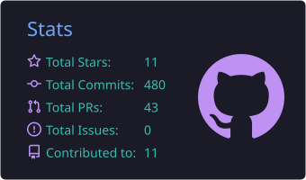

  
  
  

<h2 align="center">Software Engineer</h2>

<i>Turning ideas into shipped products.</i>

---

<h3 align="center">Tools</h3>

  
  
  
  
  
  
  
  

<h3 align="center">Languages</h3>

<!--LANGS:START-->
<!--LANGS:END-->

<h3 align="center">Stats</h3>

  

